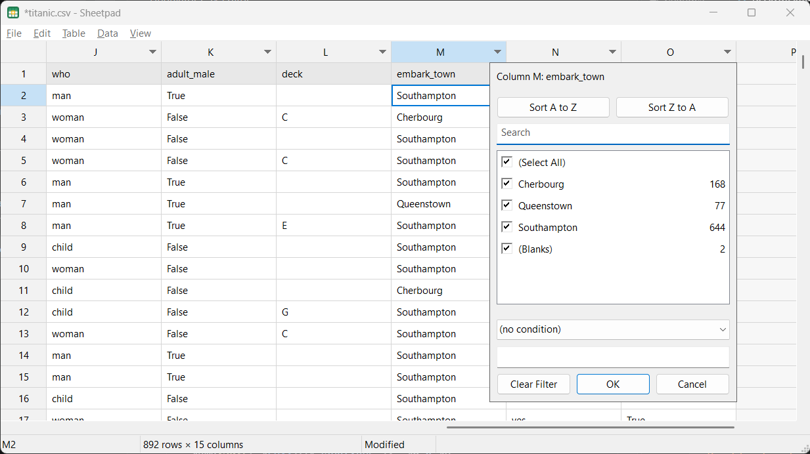

# Sheetpad

Sheetpad is a small, fast, native Windows editor for CSV and TSV files.
Sheetpad is to .csv-files what Notepad is to text files.

## Screenshot



## Features

- Spreadsheet grid
- Unlimited undo/redo
- Cut/copy/paste as TSV and HTML, paste tables into other applications
- Range, row and column selection
- Column filters, sorting, searching
- Formulas
- Formula inspector pane

## Getting started

- Type, press F2 or double-click to edit a cell
- Cells starting with `=` are treated as formulas
- When editing, press Ctrl+Enter for multi-line cells
- Press Ctrl+Shift+I to inspect formulas

## Supported file formats

| Format | Notes |
|--------|-------|
| `.csv` | RFC 4180 quoting; delimiter auto-detected (`,` `;` tab `\|`) |
| `.tsv` | Tab-separated |
| Other text files | Opened via "All files"; delimiter auto-detected |

Encodings: UTF-8 (with or without BOM), UTF-16 LE (BOM), otherwise the system ANSI
code page. Files are saved in the encoding they were opened with. CR/LF or LF line
endings and the presence of a trailing newline are preserved.

## Formulas

Type a value starting with `=`. Syntax follows Excel: operators
`+ - * / ^ & %` and `= <> < <= > >=`, absolute references (`$A$1`), ranges
(`A1:B2`, `A:A`, `1:1`), and `TRUE` / `FALSE`. Copying a formula puts its text on
the clipboard, so Excel pastes live formulas; pasting inside Sheetpad shifts
relative references like Excel.

| Function | Description |
|----------|-------------|
| `SUM(a, ...)` | Sum of numbers |
| `AVERAGE(a, ...)` | Arithmetic mean |
| `MIN(a, ...)` / `MAX(a, ...)` | Smallest / largest number |
| `COUNT(a, ...)` | Count of numeric cells |
| `COUNTA(a, ...)` | Count of non-empty cells |
| `ABS(x)` | Absolute value |
| `ROUND(x, n)` / `ROUNDUP` / `ROUNDDOWN` | Round to n digits (nearest / away from zero / toward zero) |
| `INT(x)` | Round down to an integer |
| `MOD(x, d)` | Remainder after division |
| `IF(test, a, b)` | Choose a value by condition |
| `IFERROR(x, fallback)` | Fallback when x is an error |
| `AND(...)` / `OR(...)` / `NOT(x)` | Logical operators |
| `SUMIF(range, criteria, [sum_range])` | Conditional sum |
| `CONCAT(a, ...)` | Join text |
| `LEN(text)` | Number of characters |

## Formula errors

Errors use Excel's names. The status bar and the formula inspector explain the
cause, including which input cells are themselves errors.

| Error | Meaning |
|-------|---------|
| `#DIV/0!` | A divisor is 0 or an empty cell |
| `#REF!` | A referenced row/column was deleted |
| `#VALUE!` | Wrong type of operand, e.g. text used as a number |
| `#NAME?` | Unknown function name |
| `#NUM!` | Invalid numeric result |
| `#CIRCULAR` | The formula refers back to itself (Sheetpad-specific) |

Syntax problems (unbalanced parentheses, unterminated quotes) are reported with
the same explanations.

## The sidecar file

A CSV cannot hold formulas, so the `.csv` file contains only computed values and
stays readable by any tool. Formulas and view settings are stored next to it in
`<file>.csv.formulas.json`, which is deleted when there is nothing left to store.

```json
{
  "cells": { "C2": "=A2*B2" },
  "filters": {
    "A": { "in": ["x", "y"] },
    "B": { "op": ">", "value": "10" }
  },
  "headerRow": true
}
```

- `cells`: formulas by cell address
- `filters`: saved column filters (value lists or conditions), restored on open
- `headerRow`: row 1 is a header and is excluded from filtering and sorting

Sorting is not saved. A malformed sidecar is left untouched.

## Build

The Windows executable is cross-built from Debian (or any Linux host) with the
MinGW-w64 toolchain:

```sh
sudo apt install cmake ninja-build g++-mingw-w64-x86-64-posix
cmake -S . -B build -G Ninja \
  -DCMAKE_TOOLCHAIN_FILE=cmake/mingw-w64-x86_64.cmake
cmake --build build
```

This produces `build/Sheetpad.exe`, a single statically linked executable with no
runtime DLLs to install.

Unit tests and the benchmark build natively:

```sh
cmake -S . -B build-native -G Ninja && cmake --build build-native
./build-native/core_tests
./build-native/bench 1000000 10
```

Layout:
- `src/core/`: portable, unit-tested core (CSV, document model, formulas, sidecar, filter/sort view); no Windows headers
- `src/app/`: the Win32 application (`main.cpp`, `app_*.cpp`, resources, icon)
- `tests/`: core unit tests and the benchmark
- `tools/`: `make_icon.py` regenerates `src/app/app.ico`
- `docs/`: specification, ideas and images; `site/`: GitHub Pages website
- `packaging/`: installer packaging; `.github/workflows/`: CI
